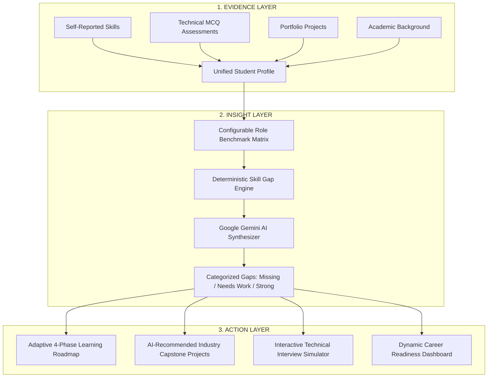
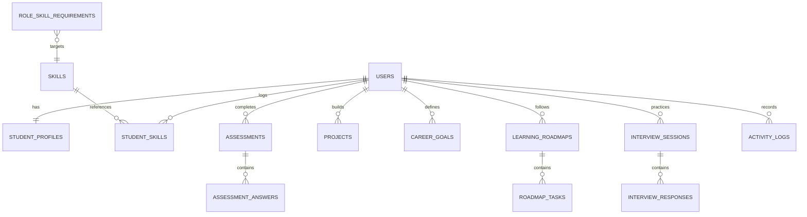

# StudentPulse AI — System Architecture Document
**Team Name:** Byte Force  
**Core Philosophy:** EVIDENCE → INSIGHT → ACTION

---

## 1. High-Level Architecture Overview

StudentPulse AI is a modern educational technology SaaS platform architected to help engineering and college students assess their technical competencies, detect skill gaps against actual employer requirements, and follow an actionable improvement roadmap.

---

## 2. Evidence → Insight → Action Philosophy

1. **Evidence (Verifiable Data Collection):**
   - The platform strictly separates **self-reported claims** from **verified assessment performance**.
   - When a student completes an assessment in one of the 8 categories (Programming, DSA, DBMS, Web Development, Software Engineering, AI/ML, Communication, Problem-Solving), the verified score is tied to the student's skill record.
   - Projects, GitHub repositories, live demo links, and academic semesters are stored as primary evidence.

2. **Insight (Deterministic & Explainable Analysis):**
   - The skill gap engine uses a deterministic, rule-based benchmark matching system across target career roles (Java Developer, Python Developer, Full Stack Developer, Frontend Developer, Backend Developer, Data Analyst, Data Scientist, AI/ML Engineer, Software Engineer).
   - Skills are weighted by role priority (High, Medium, Low) and required level (Beginner, Intermediate, Advanced).
   - If an external AI API key is not provided or Gemini is unreachable, the system automatically falls back to an explainable rule-based synthesis—preventing any service failure.
   - The AI never hallucinates student achievements, certificates, or grades.

3. **Action (Personalized Execution):**
   - Generates structured 4-phase roadmaps with duration estimates, tasks, and verified external learning resources.
   - Recommends complete project blueprints with problem statements, features, and implementation steps that students can adopt directly into their portfolio.
   - Provides mock technical interview drills with transparent rubric scoring, strengths, missing concepts, and model answers.

---

## 3. Database Entity Relationship Diagram

---

## 4. Security & Responsible AI Standards

- **Password Hashing:** Industry-standard `bcrypt` with salt rounds. Plaintext passwords are never stored.
- **JWT Authentication:** Stateless, signed JSON Web Tokens passed via `Authorization: Bearer <token>` headers.
- **Data Privacy & Tenant Isolation:** Each student only accesses, modifies, and views their own private profile, projects, and assessments.
- **Responsible AI Guardrails:**
  - Clear visual indicators distinguish self-reported claims from verified assessment scores.
  - Transparent rubric scoring criteria for interview evaluations.
  - No guaranteed placement or employment claims.
  - Safe error fallbacks ensuring 100% platform availability offline or without API keys.

